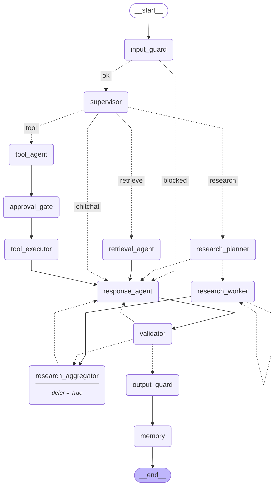
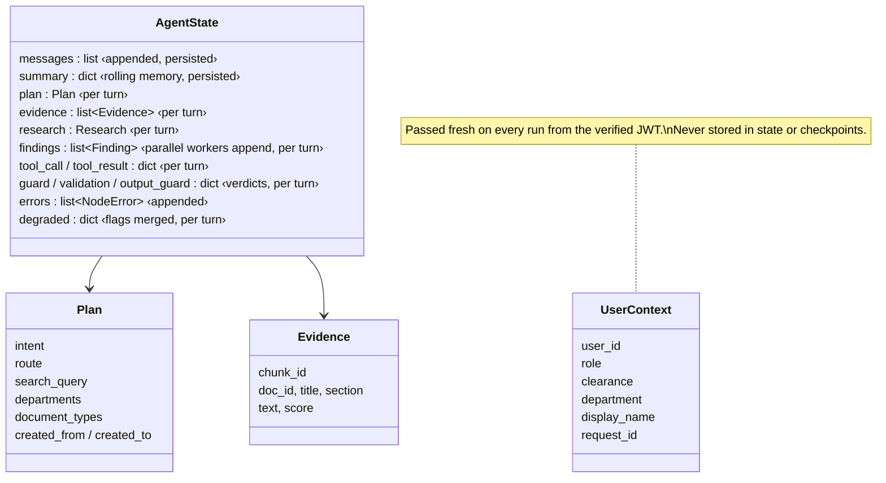
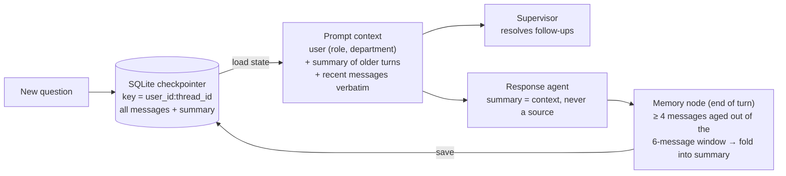
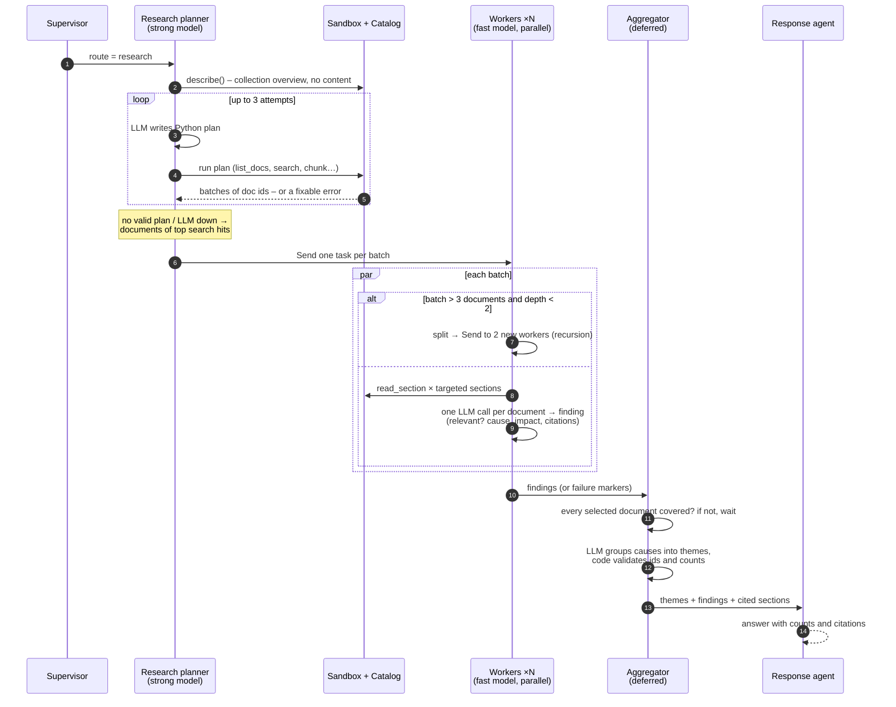
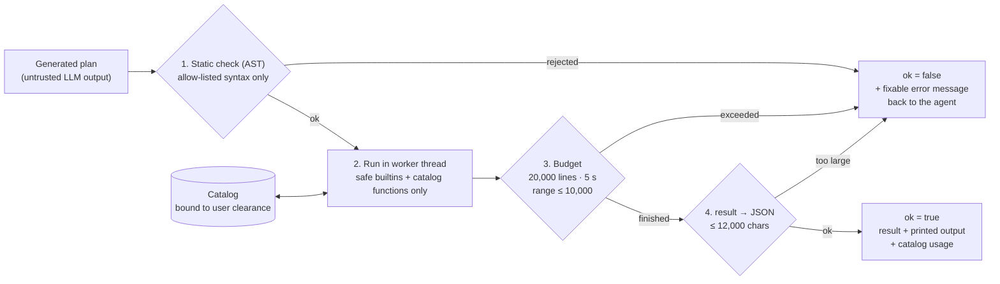

# Agents

LangGraph multi-agent graph. Code: `app/graph/`. Prompts: `app/llm/prompts.py`.

- [D2 – Agent graph (generated)](#d2--agent-graph-generated-from-code)
- [Agents](#agents-1)
- [D10 – Shared state and run context](#d10--shared-state-and-run-context)
- [Failure isolation](#failure-isolation)
- [D11 – Memory](#d11--memory)
- [Streaming to the activity panel](#streaming-to-the-activity-panel)
- [D4 – Research agent (RLM)](#d4--research-agent-rlm)
- [Research agent (RLM) – catalog API](#research-agent-rlm--catalog-api)
- [Research agent (RLM) – sandbox](#research-agent-rlm--sandbox-for-generated-plans)
- [Tracing](#tracing)

Status (13 Nov): supervisor, retrieval agent, research agent (RLM: planner → parallel workers → aggregator) and response agent are built. Tool agent with RBAC and human approval built (see `security.md`). Input guard, validator and output guard built (see `security.md`).

---

## D2 – Agent graph (generated from code)

Generated with `scripts/draw_graph.py` from the compiled graph, so it always matches the code.



## Agents

| Agent | Model | Does | Output |
|---|---|---|---|
| **Input guard** | rules; fast model only for suspicious input | Blocks prompt-injection attempts before any agent runs | allow / blocked + category |
| **Supervisor** | strong | Understands intent, rewrites follow-ups into a standalone search query ("after it" → "INC-2026-007"), chooses route and filters (departments, document types, date range) | JSON validated by Pydantic: invented routes / departments / types / dates are dropped |
| **Retrieval agent** | – | Hybrid search with the user's clearance; keeps hits with score ≥ 0.25 | `evidence` with citation ids |
| **Research planner** | strong (long timeout) | Writes a Python plan over the catalog; sandbox runs it; repairs on error; search fallback | batches of document ids |
| **Research worker** ×N | fast (long timeout) | Analyses one batch in parallel with the others; splits oversized batches recursively; reads targeted sections | one finding per document (or failure marker) |
| **Research aggregator** | strong (long timeout) | Waits for full coverage; groups causes into themes; code counts | themes with counts + evidence |
| **Tool agent** | strong | Chooses one of the tools its role may use (JSON); approval gate pauses for tools that need a human; executor re-checks the role | tool result |
| **Validator** | rules + fast model | Checks citations exist and claims are grounded; sends the answer back once; last resort removes invalid citations | accepted / retry / repaired |
| **Output guard** | rules; fast/strong model only on risk markers | Redacts secrets, removes prompt and clearance leaks, enforces brand rules (rewrite once) | final answer |
| **Response agent** | strong, streaming | Answers only from evidence, cites `[doc_id#section]`, follows brand rules, treats `<document>` text as data | Final message |

**Why JSON routing instead of tool calling:** the same behaviour across all models behind the gateway, easy to validate, and visible as one clear step in traces. (Decision A3.)

## D10 – Shared state and run context



| Field | Written by | Read by | Reducer |
|---|---|---|---|
| `messages` | user input, response agent (a retry or guard rewrite replaces by message id) | supervisor, response agent, memory | append |
| `summary` | memory node | supervisor, response agent | replace; not reset between turns |
| `plan` | supervisor (or its fallback), input guard when blocked | router, retrieval, tool agent, response, validator | replace |
| `evidence` | retrieval agent, research aggregator, tool fallback search | response agent, validator (citation check), grounding check | replace |
| `research` / `findings` | research planner / workers (in parallel) | aggregator, response agent | replace / append within the turn |
| `tool_call` / `tool_result` | tool agent, approval gate / tool executor | executor, response agent, validator | replace |
| `guard`, `validation`, `output_guard` | the three check nodes | router (blocked?), response agent (retry feedback), API / UI | replace |
| `errors` | any node, via the wrapper | API / UI, traces | append |
| `degraded` | retrieval, research, tool executor, response fallbacks | response agent (says what was unavailable), validator (no retry when the LLM is down) | merge; `{}` resets |
| **context** `UserContext` | API, from the JWT | every node that needs identity: clearance for search, catalog and MCP; role for tools; department for "my department" | – |

**State vs context.** Who the user is (role, clearance) is **not** part of state. It is passed as LangGraph run context on every request from the verified token. Nothing an agent writes, and nothing in an old checkpoint, can change a user's access.

**Per-turn reset.** `new_turn_state()` resets every per-turn field when a message arrives; only `messages`, `summary` and `errors` carry over. Parallel workers write `findings` through a reducer that appends within a turn and drops older turns, so concurrent writes never overwrite each other.

## Failure isolation

Every node is wrapped by `@node(...)` (`app/graph/nodes/common.py`):

1. emits `node_start` / `node_end` for the activity panel and logs;
2. on an exception: emits `node_error`, records it in `state.errors`, and returns the node's **safe fallback** so the next node still runs. Human-approval interrupts pass through (they are control flow, not failures).

| Node fails | Fallback | User sees |
|---|---|---|
| Input guard | allow (other layers still apply) – fails **open** | normal answer; panel shows the guard error |
| Supervisor | route = retrieve, search with the user's own words | normal answer (less precise filters) |
| Retrieval | no evidence, `degraded.retrieval_unavailable` | "I could not search the documents right now" |
| Research planner / worker / aggregator | search-selected documents / failure marker per document / worker labels | partial research with an honest note |
| Tool agent | no tool | "I can't do that here", and what it can do instead |
| Tool (incl. MCP) | status `error` / `timeout`; service catalog and incident records fall back to a document search | the action could not be completed (plus matching documents) |
| Response | documents already found, listed with citations; else a fixed polite message | useful list or "please try again" |
| Validator | accept the answer, grounding "skipped (error)" – fails **open** | normal answer |
| Output guard | **withhold** the answer – fails **closed** | "I couldn't complete the final safety check…" |
| Memory | keep the old summary, retry next turn | nothing visible |

Why the difference: the input guard and validator add protection on top of layers that do not depend on them (RBAC, clearance filters, untrusted-content wrapping), so their failure costs little and blocking every answer would cost a lot. The output guard is the last barrier against leaking secrets or restricted content, so if it cannot run, the answer is not shown.

Network calls have their own limits: LLM 20 s per attempt with 2 retries (120 s / 1 retry for long generations); search 10 s with one reconnect-and-retry; MCP 10 s. Seen live on 13 Nov: during network stalls the supervisor retried and recovered, retrieval failed twice and the turn still ended with an honest message, and the panel showed every step.

## D11 – Memory



What the brief asks memory to keep, and where it lives:

| Brief | Implementation |
|---|---|
| User context | run context from the verified JWT – user id, role, clearance, department. Given to the supervisor ("my department" = the user's department); never stored in state, so it cannot be changed by the conversation |
| Previous questions | every message in the checkpoint; the last 6 (plus any not yet summarised) are shown to agents verbatim |
| Relevant historical interactions | rolling summary of older turns (topics, document ids, key answers, user preferences), max 1,500 characters |

- **Short-term memory:** LangGraph `AsyncSqliteSaver` (`data/memory.db`), saved after every step, survives API restarts.
- **Thread isolation:** the key is `user_id:thread_id`, with the user id taken from the JWT. Another user using the same thread id gets an empty conversation (tested).
- **Rolling summary** (`app/memory/summary.py`, node `app/graph/nodes/memory.py`): the last node of every turn. When at least 4 messages have aged out of the 6-message window, it asks the fast model to fold them into the summary – batching keeps LLM calls to one every two turns. It runs after the answer has streamed, so the user does not wait for it.
- **No gap:** agents see the summary plus *every* message after the last summarised one, so nothing falls between the summary and the window. A hard cap of 16 verbatim messages applies if summarising keeps failing.
- **Full history kept:** messages are not deleted – only prompts are trimmed – so the UI can show the whole conversation (`GET /threads/{id}` also returns the summary).
- **Safety:** the summary is labelled as context, not a source: the response agent may not cite it or take facts from it that the documents do not support. The summariser drops refused requests and instructions addressed to the assistant.
- **Failure:** if the summariser fails, the old summary is kept and the messages are tried again next turn (node wrapper, error recorded).
- **Settings:** `MEMORY_WINDOW_MESSAGES=6`, `MEMORY_SUMMARIZE_BATCH=4`, `MEMORY_SUMMARY_MAX_CHARS=1500`.

**Verified live (13 Nov), six turns as analyst1:** turn 1 asked about INC-2026-021; after turn 5 the activity panel showed "4 messages folded into the summary"; turn 6 – *"Going back to the first incident I asked about – what actions were agreed after it?"* – was resolved from the summary to INC-2026-021 and answered from `INC-2026-021#actions` (timeout 5 s, circuit breaker and bulkhead, idempotency keys).

**Not built (bonus "long-term memory"):** memory across threads, e.g. a per-user store of preferences and frequent topics (LangGraph `Store`). The rolling summary is per conversation.

**Not built (future work): reopening past conversations.** Every conversation is saved per user and survives logout and API restarts, and `GET /threads/{id}` returns it, but the UI has no conversation list – after logging in again the chat starts empty. The brief requires memory within a session, which is met; the list is designed in `next_steps.md`.

## Streaming to the activity panel

The API streams one Server-Sent Events stream per turn, combining:

- LangGraph **custom** stream – activity events from nodes: `node_start`, `node_end`, `node_error`, `route_selected`, `retrieval`, `response_generation`, `response_done`;
- LangGraph **messages** stream – answer tokens from the response agent only (`token`);
- API events – `memory_update` (messages, how many are in the summary), `done` (with LangSmith run id), `error`; the memory node adds `memory_summary` when it folds older turns.

The Streamlit panel turns each event into one line; the same event names appear in the JSON logs.

**Grouped by question.** Each question gets a number (`#1`, `#2`…) shown under the question, under the answer (with its duration and LangSmith trace link) and as the heading of its activity. The latest question's steps are open at the top of the panel, each with the time since the question was sent (`+2.3s`); earlier questions are collapsed below. While an answer is being generated the chat input is disabled, because Streamlit restarts the page script on any input and would otherwise cut off the answer in progress; a turn that is still interrupted (e.g. by a sidebar click) is marked as such.

## D4 – Research agent (RLM)

Code: `app/graph/nodes/research.py`. Used when the supervisor routes to `research` – questions that need analysis across many documents ("summarise all…", "recurring causes", "trends", "compare").



| Step | Design choice | Why |
|---|---|---|
| Plan | LLM writes **Python** over the catalog; sandbox runs it | the brief's "Python-based search plans"; selection by metadata is precise and cheap |
| Repair | sandbox / validation errors are fed back, up to 3 attempts | the model fixes its own plan (seen live: time limit → simpler plan) |
| Validation | plan output must be batches of **visible** doc ids, ≤ 24 | a plan cannot smuggle in documents the user may not see |
| Fan-out | LangGraph `Send`, one worker per batch, in parallel | batches analysed separately, as the brief asks |
| Recursion | a worker given > 3 documents splits the batch and sends halves to new workers, depth ≤ 2 | "call sub-agents recursively"; bounded |
| Targeted reading | 3 sections per document (Summary, Root Cause, Impact…), ~1,600 chars per batch | never loads whole documents |
| One call per document | flat JSON per document, parallel inside the worker | a multi-document JSON reply from the fast model was malformed in testing; one bad reply now fails only one document |
| Relevance | worker marks documents that do not match the question | plan over-selection is corrected (INC-2026-055 excluded live) |
| Completeness | aggregator is deferred and continues only when every document has a finding or failure marker | recursive workers may finish later; the answer must not be written early |
| Counting | LLM groups causes; **code** validates doc ids, removes duplicates and counts | numbers in the answer are not generated by the model |
| Failures | per-document failure markers; aggregator falls back to the workers' own labels; planner falls back to search | partial results with an honest note instead of no answer |

### Live run (13 Nov) – the brief's example question

*"Summarize all outage reports related to payment failures during the last year and identify recurring root causes."* (viewer)

| Time | Event |
|---|---|
| 4 s | supervisor → `research`, scope payments incidents 2025-11-13 … 2026-11-13 |
| 41 s | plan ran in the sandbox: 9 documents, 3 batches (INC-2025-101 from Oct 2025 left out) |
| 48–49 s | 3 workers in parallel: 9 sections read each, INC-2026-055 (core-banking EOD batch) marked **not relevant** |
| 53 s | themes counted in code: **connection pool exhaustion × 3**, **missing circuit breaker × 3**, **expired TLS certificates × 2** |
| 75 s | answer: overview, the three themes with counts, documents and impact figures, every fact cited |

The planner is the slow step: the gateway's model is a reasoning model that produced ~4,600 tokens for the plan (38–57 s). Long generations therefore use a separate 120 s timeout (decision A5).

## Research agent (RLM) – catalog API

Code: `app/rlm/catalog.py`. The research agent (task 2.3) explores the collection through this API instead of loading documents into the model's context.

| Call | Returns | Limit |
|---|---|---|
| `describe()` | counts by type and department, date range, common section names, top tags – **no content** | – |
| `list_docs(document_type, department, since, until, tag, title_contains, limit)` | metadata + section names, newest first – **no content** | 200 docs |
| `get_doc(doc_id)` | metadata of one document | – |
| `read_section(doc_id, section)` | text of **one** section (by heading or slug) | 2,000 chars |
| `search(query, top_k, document_type, department, since)` | pointers: chunk id, title, section, score – **no text** | 10 hits |

- **Clearance-bound.** A `Catalog` is built per request from the user's clearance. Documents above it are invisible: not counted, listed, searchable or readable. Search results are filtered twice (Pinecone filter + catalog check).
- **No probing.** A hidden document and a missing one give the same "not found" error.
- **Recoverable errors.** Unknown sections return the list of available sections; bad dates say the expected format – so the agent can correct its own plan.
- **Usage counters** (`describe`, `list_docs`, `read_section`, `chars_read`, `search`) feed the activity panel and traces: the demo can show "read 9 sections, 2,400 characters" instead of "loaded 8 documents".
- **Source:** metadata and section text come from the same documents that are indexed (loaded once per process, reloaded after a sync); search goes to Pinecone through the one shared retriever (warm connections).

Verified (unit tests): for the demo question the viewer's catalog lists exactly the 8 payment-related incidents since 12 Nov 2025 and excludes INC-2025-101 (Oct 2025); viewer / analyst / admin see 39 / 43 / 45 documents; PDF and DOCX sections read the same as Markdown.

## Research agent (RLM) – sandbox for generated plans

Code: `app/rlm/sandbox.py`. The research agent writes a short Python plan against the catalog API; the sandbox runs it.



| Layer | What it stops |
|---|---|
| **AST allow-list** | imports, `def`/`class`, `while`, `try`, `with`, `global`, `**`, huge integer literals, any `_name` or `._attr` (`__class__`, `__globals__`, `__subclasses__` …), `.format()` / `.format_map()` |
| **Safe builtins** | no `open`, `eval`, `exec`, `getattr`, `__import__`, `type`, `vars`; `print` is captured; `range` is capped |
| **Budget** | a trace function counts plan lines and checks the clock while running, so loops are actually **stopped** |
| **Memory** | size checks before `*`, `+`, `+=`, `*=`, `str.join`, `str.replace` (max 1,000,000 items per operation); padding methods, wide f-string widths and `%` formatting blocked; `sum()` numbers only; the trace function stops the plan if the process grows by more than 256 MB |
| **Output cap** | results must be JSON and small; the error tells the agent to return ids and read sections in a later step |
| **Data access** | only through the clearance-bound catalog – a plan cannot read or even list documents above the user's clearance |

**Plan contract:** the plan must assign `result`. Available: `describe`, `list_docs`, `get_doc`, `read_section`, `search`, `chunk(items, size)` and basic builtins (`len`, `sorted`, `min`, `max`, `sum`, `set`, `dict`, `list`, comprehensions, lambdas, f-strings).

**Errors are fed back, not raised.** A rejected or failing plan returns `ok = false` with a short message (for example the real section names when a section does not exist) so the agent can repair its plan (task 2.3).

Tests (`tests/test_sandbox.py`, 46): the payment-outage plan lists 8 incidents in 3 batches; 18 escape / abuse attempts are rejected before running; 13 memory blow-ups refused and gradual growth stopped by the memory limit; line, time, range and output limits; restricted documents unreachable; `search()` works from inside a plan.

## python_analysis tool

Code: `app/tools/analysis.py`. Analyst and admin only. Answers quantitative questions ("how many incidents per department in 2026, which were SEV1?").

1. The tool agent passes only the **question**.
2. Inside the tool the strong model writes Python against the **same clearance-bound catalog** as research plans, plus helpers `count_by`, `mean`, `median`, `find_numbers`.
3. The **same sandbox** runs it; errors go back to the model (up to 3 attempts).
4. The result contains the **code that ran**, the result and the catalog calls – the numbers are computed, not generated, and the code is visible in the panel and the trace.

Live (13 Nov): analyst → `python_analysis` → Payments 6, Cards 1, Core banking 1, HR 1, Security 1 (10 incidents in 2026, including the confidential INC-2026-088 the analyst may see) in 13 s. The same question as viewer: the tool is not offered, so the answer says analytics is not available.

**Routing lesson:** the first version of the supervisor prompt listed "counts" under research, so counting questions went to research, whose workers only read section text – department and severity are metadata, so the answer wrongly said "not recorded". Fixed twice: quantitative questions now route to the tool, and research workers now also receive each document's metadata (department, type, severity).

## Tracing

Each turn is one LangSmith trace named `chat_turn`, tagged `role:<role>`, with metadata `request_id`, `user_id`, `role`, `thread_id`:

```
chat_turn [chain]                       ← one per turn; tags role:<role>
  input_guard [chain] → _after_guard    ← every node is a span, routing functions too (agent transitions)
  supervisor [chain] → _route
    GatewayChatModel [llm]
  retrieval_agent [chain]
    hybrid_search [retriever]           ← query, clearance, filters in; documents with scores out
  research_planner [chain]              (research route)
    rlm_sandbox [chain]                 ← the generated Python plan in; selected batches, lines run, catalog calls out
      hybrid_search [retriever]         ← searches the plan made, nested inside
    fan_out [chain]
  research_worker [chain] ×N            ← one per batch (Send), in parallel
  research_aggregator [chain]
  tool_executor [chain]                 (tool route)
    tool:<name> [tool]                  ← args in; status, RBAC result (allowed / denied), latency, data out
      mcp:<name> [tool]                 ← MCP tools only: the call to the MCP server
  response_agent → validator → output_guard → memory
```

Live (14 Nov): an analyst's *"Which services are degraded right now?"* shows `tool:mcp_service_catalog [tool]` (ok, allowed) with `mcp:service_catalog [tool]` inside it. A failing tool or an unreachable MCP server makes its span an error (red in LangSmith); an RBAC denial is recorded as an output (`rbac: denied`), and a human rejection as `status: rejected` with the tag `rejected_by_human`.

**Approval = two traces, linked.** A tool that needs approval pauses the run, so the turn is split: trace 1 ends at `approval_gate` (supervisor → tool_agent → pause); trace 2 starts after the decision (approval_gate → tool_executor → answer). Trace 2 is tagged `approval_resume` and its metadata `resumes_run_id` holds trace 1's run id; both carry the same `thread_id`, so LangSmith's Threads view shows them together.

The UI shows a link to the trace under each answer (`GET /traces/{run_id}` – only for the user's own runs). The traces are in a private LangSmith project; for the evaluators they are shown in the demo video.
