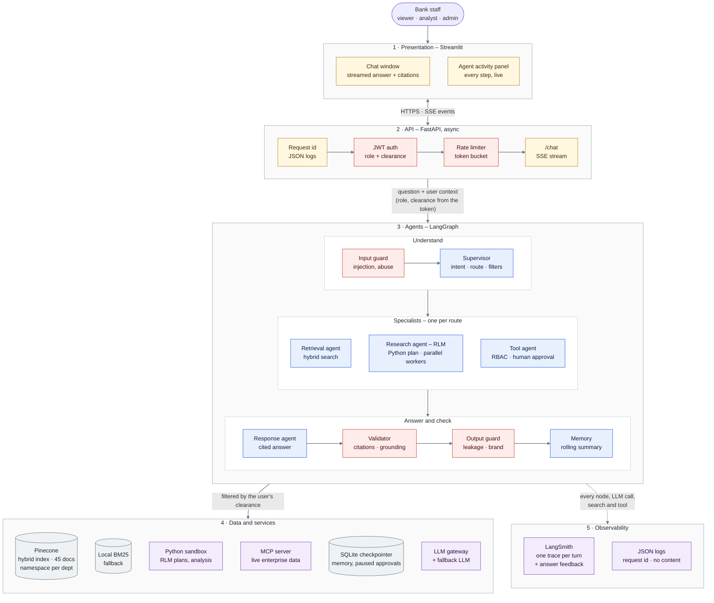
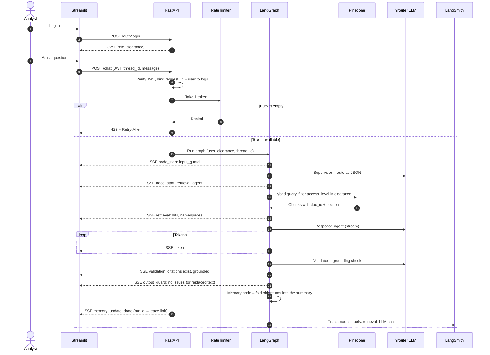
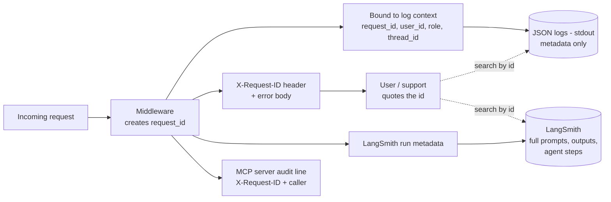
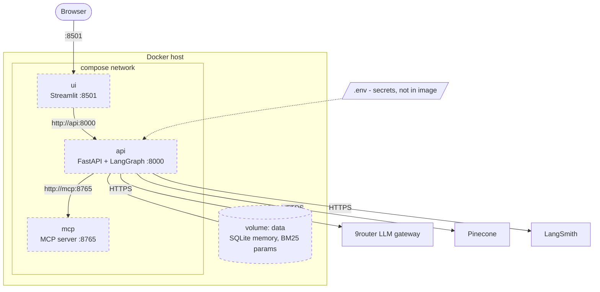

# Architecture

Internal staff knowledge assistant for Commercial Bank of Ceylon PLC.
Diagrams are Mermaid (rendered by GitHub). Components drawn with **dashed borders are planned** and not built yet; this file is updated as each part is built.

- [D1 – System architecture](#d1--system-architecture)
- [D3 – Request lifecycle](#d3--request-lifecycle)
- [D12 – Observability and correlation](#d12--observability-and-correlation)
- [D14 – Deployment (Docker Compose)](#d14--deployment-docker-compose)

Related: agent graph and state (D2, D4, D10, D11) in `agents.md`, retrieval (D5, D6) in `retrieval.md`, security (D7, D8) in `security.md`, failure handling (D9) in `resilience.md`.

---

## D1 – System architecture

*Colours:* blue = agents · red = guards and access control · grey = data stores · purple = services and telemetry · amber = UI and API entry points.

**How to read it**

- **Five tiers, top to bottom:** presentation, API, agents, data and services, observability. The agents tier reads in three steps: understand (guard + supervisor), one specialist per route, then answer and check.
- **Identity and limits first.** Every request passes the middleware (request id, logging), then authentication and the per-user rate limiter before reaching the agents.
- **One graph, many agents.** The supervisor routes to specialist agents; every answer is checked by the validator and the output guard (which can replace the streamed text), then the memory node updates the conversation summary.
- **Data access is filtered by the server.** The retrieval filter on `access_level` comes from the user's token, never from the LLM.
- **Every dependency has a fallback.** Pinecone → local BM25, LLM gateway → direct provider, MCP or tools down → answer from documents with a note (see D9).
- **Two kinds of telemetry.** JSON logs for operations, LangSmith for full agent traces (see D12).

**Built so far:** middleware (request id, JSON logs), login, `/health`, LLM factory, Pinecone hybrid retrieval with sync, LangGraph graph (supervisor → retrieval or research (RLM) → response) with SQLite session memory, `/chat` SSE streaming, Streamlit chat + activity panel, LangSmith traces. Tool agent with RBAC and approval. Input guard, validator and output guard. Rate limiter. Python analysis tool. Local BM25 fallback and fallback LLM (optional, configured via `FALLBACK_LLM_*`); fault injection for demos (`docs/resilience.md`). MCP server (`mcp_server/`, separate process) with three tools for analysts. Rolling conversation summary.

---

## D3 – Request lifecycle

One question from a logged-in analyst, end to end.

**Points shown**

- Every step is async; the UI sees progress events while the graph runs, not only the final answer.
- The rate limit is checked before any LLM cost is spent.
- The trace is sent to LangSmith in the background and linked in the final event.

---

## D12 – Observability and correlation

How one `request_id` connects what the user sees, the logs and the trace. Details: `logging.md`.

- **Logs** answer "what happened and how long did it take" without storing message content.
- **LangSmith** answers "why did the agent do that" with the full trace.

---

## D14 – Deployment (Docker Compose)

Designed, not built (bonus item deferred – decision A9). Today the three processes are started separately (README).

