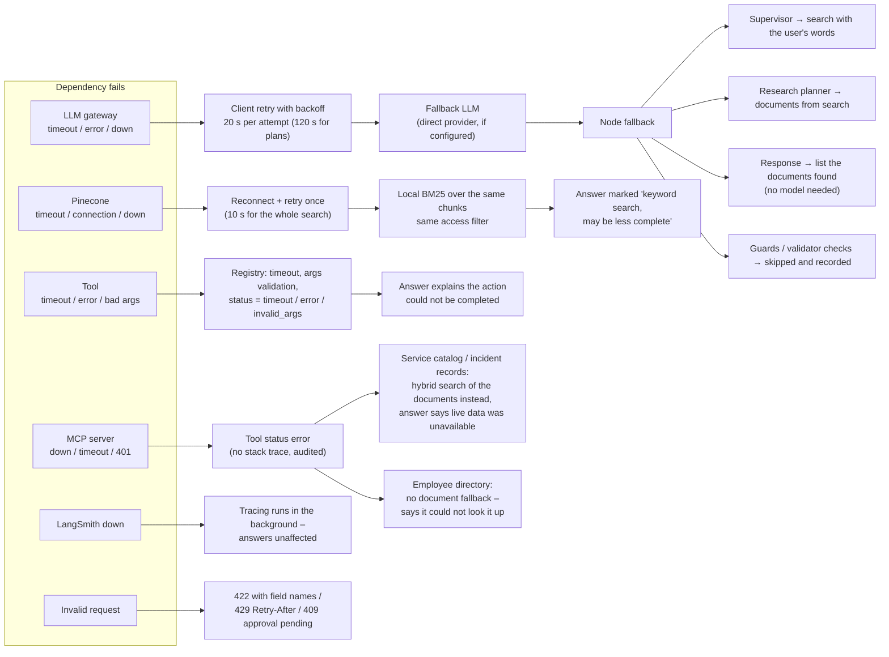

# Resilience and error handling

How the assistant behaves when a dependency fails. Code: node wrapper `app/graph/nodes/common.py`, LLM factory `app/llm/factory.py`, retriever `app/retrieval/hybrid.py` + `local_index.py`, tool registry `app/tools/registry.py`, fault injection `app/faults.py`.

Principle: **every failure is contained where it happens and turned into a weaker but honest answer** – the user is never left with a spinner or a stack trace, and the panel, logs and trace show what degraded.

## D9 – Failure and degradation map

| Failure | Contained by | What the user gets |
|---|---|---|
| LLM returns unusable structured output (truncated JSON, missing field) | `invoke_json`: validate against the schema, ask again with the reason, 3 attempts | normal answer, a few seconds later |
| LLM slow / errors | client retries (20 s, 2 retries; 120 s / 1 retry for long generations) → optional fallback provider | normal answer, a bit later |
| LLM down | each node's fallback | **the relevant documents with their sections and citations** (retrieval still works), "try again for a written answer" |
| LLM down during research | planner falls back to search-selected documents; per-document failure markers; aggregator falls back to worker labels | partial research with an honest note |
| Pinecone slow / stale connection | reconnect + one retry | normal answer |
| Pinecone down | **local BM25** over the same chunks and access rules | answer from keyword search, marked as possibly less complete |
| Both search paths down | retrieval node fallback | "I could not search the documents right now" |
| MCP server down / timeout | registry (status `error`), then a document search for tools with `search_fallback` (service catalog, incident records) | the incident reports / runbooks that match, with citations, and a note that live data could not be checked |
| Tool timeout / error / bad arguments | registry (`asyncio.wait_for`, Pydantic) | the action could not be completed; nothing invented |
| Grounding / brand / injection classifier down | check skipped and recorded in the panel | answer still validated by the deterministic checks |
| Validator rejects twice | invalid citations removed, first answer kept if the rewrite is empty | answer with a short note |
| Invalid request | Pydantic | 422 naming the field (no input echoed back) |
| Too many requests | token bucket | 429 + `Retry-After` |
| Unexpected exception | node wrapper / global handler | node fallback; or 500 with a request id (details in the log only) |
| LangSmith down | tracing is asynchronous | nothing visible to the user |

**No butterfly effect.** A failing node records the error in `state.errors` and returns its safe fallback, so the next node still runs; one failure does not cascade into the rest of the graph. Each fallback is chosen so the next step can still do something useful (e.g. a supervisor failure still produces a search query).

## Demonstrating failures (fault injection)

Real outages cannot be scheduled for a demo, so an administrator can simulate them:

- UI: sidebar → **Simulate outages (demo)** (admin only) – Pinecone down / LLM gateway down / MCP down.
- API: `POST /admin/faults {"pinecone": true}` (admin only, 403 for others); `GET /admin/faults`; `/health` lists active simulated faults.

The check sits at the boundary to the real dependency (`PineconeStore.embed/query`, the chat model's generate/stream), so retries, fallbacks and degraded answers run exactly as they would in a real outage. Off by default; in-memory, so a restart clears it.

### Live (13 Nov)

| Simulated | Observed |
|---|---|
| Pinecone down | panel: *vector search unavailable → local keyword search*; RB-003 found first; full cited, grounded answer in 29 s |
| LLM gateway down | supervisor and response failed in < 120 ms (no hanging); retrieval still ran; the answer listed RB-003 and INC-2026-095 with their sections and citations in 7 s; validator accepted it without retrying |
| Invalid thread id | 422 `validation_error`, field `body.thread_id` |
| MCP down (analyst: *"Show me the incident tickets for the PayBridge service"*) | tool `error` in 3 ms, then document search; the answer said the ticket list was unavailable and summarised the PayBridge incident reports instead |
| MCP server not running | `ConnectError` → status `error` after ~2 s, no hang |

Earlier, unplanned: the office network stalled new connections for 30–60 s and the gateway sometimes hung – the retry/timeout design (decision A14) came from those real failures.

## Known limits

- Fault injection simulates "down", not "slow"; slow paths are covered by timeouts and were seen live.
- The fallback LLM is built but only active when `FALLBACK_LLM_*` is configured.
- The local BM25 index lives in memory per process (rebuilt after a sync); fine for this corpus size.
