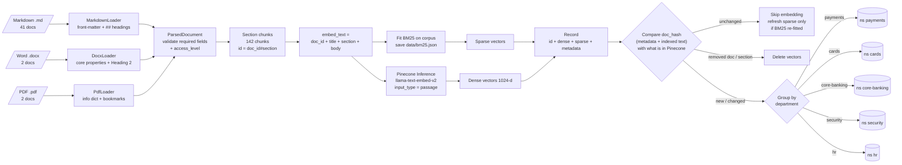
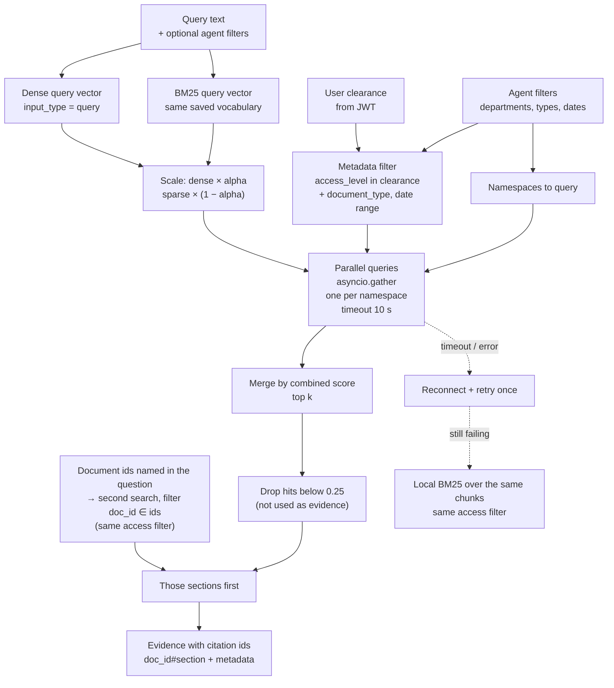
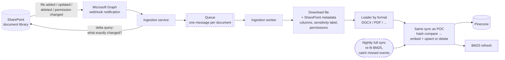

# Retrieval

Hybrid search over the bank's documents in Pinecone. Code: `app/retrieval/`, ingestion: `scripts/ingest.py`.

## Summary

| Item | Choice |
|---|---|
| Vector DB | Pinecone serverless, one index `orysys-kb`, metric **dotproduct**, 1024 dims |
| Dense | Pinecone Inference `llama-text-embed-v2` (`passage` for documents, `query` for questions) |
| Sparse | **BM25** (`pinecone-text`), fitted on our corpus, saved to `data/bm25.json` |
| Hybrid score | `alpha * dense + (1 - alpha) * sparse`, `HYBRID_ALPHA=0.6` |
| Namespaces | one per department: `payments`, `cards`, `core-banking`, `security`, `hr` |
| Chunking | one chunk per `##` section; id `<doc_id>#<section-slug>` is also the citation id |
| Access control | `access_level ∈ user clearance` filter on every query, built from the JWT |
| Attribution | metadata on every chunk: `doc_id`, `title`, `section`, `department`, `document_type`, `access_level`, `created_date` |

---

## D6 – Ingestion pipeline

- **Format is only the first step.** Each loader returns the same `ParsedDocument` (metadata + sections); everything after it is shared. Converted samples give the same citation ids as their Markdown originals (kept in `data/samples_src/`). See decision A10.
- **Sync, not just upsert** (`app/retrieval/sync.py`, decision A11). Each chunk stores a `doc_hash` (text + metadata). A sync compares the documents on disk with Pinecone: new and changed documents are embedded, **deleted documents and removed sections are deleted**, unchanged documents are not re-embedded. Pinecone is the record of what is indexed – no separate manifest. Changing only a document's access level also triggers a re-index.
- **BM25 is re-fitted on every change** (term weights depend on the whole corpus). Unchanged chunks get their sparse values updated in place, without re-embedding; the API reloads the new vocabulary on the next query.
- **Commands:** `scripts/ingest.py` (sync), `--dry-run` (report only), `--full` (re-embed everything).
- **Namespaces are upserted in parallel** (`asyncio.gather`).
- **Validation at load time:** a document without a valid `access_level` fails ingestion instead of becoming searchable without protection.

## D5 – Hybrid query

## Why these choices

- **Section chunks, not fixed-size windows.** The documents are structured (Summary, Root Cause, Actions). A section is a meaningful unit to cite ("INC-2026-007#root-cause") and lets the research agent read only what it needs.
- **Title + heading in the embedded text.** A "Root Cause" section alone does not say which system it is about; adding the title fixes that.
- **BM25 fitted on our own corpus.** Bank terms ("PayBridge", "connection pool", "EOD") get proper weights; the saved vocabulary keeps ingestion and queries consistent.
- **One index, dotproduct.** Pinecone needs dotproduct to combine dense and sparse scores in one query; scaling the query vectors gives the weighted sum without a second index or client-side fusion.
- **Namespaces per department.** Mirrors how a bank organises knowledge, lets the agent narrow a search (`departments=["payments"]`) and queries run in parallel. Trade-off: a cross-department search makes 5 small queries instead of 1.
- **Access filter from the token.** The retriever requires a clearance list and always adds it; agent filters can only narrow results further.
- **Dates stored twice.** `created_date` (ISO, for display) and `created_int` (yyyymmdd) because Pinecone range filters only work on numbers.

## Document ids in questions

Staff often ask by id: *"What actions followed INC-2026-021?"*. Two things make that work:

1. **The id is part of the indexed text** (`"<doc_id> <title>\n<section>\n<body>"`), so BM25 matches the token `inc-2026-021`. Before 13 Nov the id lived only in metadata, and *"What happened in incident INC-2026-021?"* found nothing above the relevance threshold. The sync hash now covers the indexed text, so this change re-embedded all 142 chunks automatically.
2. **Named-document search.** An id is still one token among many, so ranking alone put other incidents' "Actions" sections first. When the question names ids, the retrieval agent runs a second search inside those documents only (metadata filter `doc_id $in [...]`, plus the usual access filter) and puts those sections first (`retrieval_named_docs` event).

A user cannot reach a document above their clearance by naming it: the access clause is on both searches.

## Future enhancement – size cap for long sections

**Today:** one chunk per section, with no upper size. The mock sections are short (longest 479 characters), so every chunk embeds well. A real 10-page policy with one long section would become a single oversized chunk: it embeds poorly (one vector for many topics) and can exceed the embedding model's input limit.

**Planned:** keep section chunking, and split only sections above a configurable size.

| Aspect | Design |
|---|---|
| When | a section longer than about 1,200 characters (setting in `config.py`) |
| How | split on paragraph, then sentence boundaries, with about 150 characters of overlap so a fact on a boundary is in both parts |
| Chunk ids | `POL-009#eligibility-2` – the section name stays, so citations stay readable and the existing citation check accepts them |
| Research agent | `read_section` joins the parts, so plans still read a whole section |
| Existing index | short sections produce the same chunks as today – nothing is re-embedded |

**Why not fixed-size windows everywhere** (e.g. 1100 characters / 200 overlap on the whole document): simpler, but it cuts across section boundaries and turns a citation like "Root Cause" into "chunk 7". Section-first with a size cap keeps both precise citations and safe chunk sizes.

**Not built in the POC** because no sample document needs it; it changes one function (`build_chunks` in `app/retrieval/loader.py`) and the catalog's `read_section`.

## Verified behaviour (13 Nov)

| Check | Result |
|---|---|
| "PayBridge circuit breaker timeout" | top hits: INC-2026-021 root cause / actions, INC-2026-062, RB-003 |
| "executive bonus structure" as **viewer** | POL-007 (restricted) **not returned** |
| same query as **admin** | POL-007 sections ranked first |
| incidents since 12 Nov 2025 | INC-2025-101 (Oct 2025) excluded by the date filter |
| `departments=["payments"]` | only the payments namespace queried |
| "slow query exhausted the connection pool…" | top 3 from INC-2026-078 – a **PDF** document |
| "month-end checklist read replica…" | RB-002 checklist – a **Word** document – ranked first |
| alpha = 1.0 vs 0.0 | different rankings – dense finds related actions, BM25 finds exact keyword matches |

## D16 – Live environment: SharePoint as the document source

Assumption for production (decision A11). The POC folder `data/docs` stands in for the SharePoint library; the sync logic is the same.

| POC | Live environment |
|---|---|
| Folder `data/docs` | SharePoint document library |
| Run `scripts/ingest.py` or admin `admin_reindex` tool | Graph webhook + delta query trigger automatically |
| Metadata in front-matter / file properties | SharePoint columns, sensitivity labels, permissions |
| Full sync each run | Per-document sync from a queue + nightly full sync |

### Sync test (13 Nov)

| Step | Result |
|---|---|
| First sync after adding `doc_hash` | 45 updated, 142 chunks upserted (one-time migration) |
| Run again, nothing changed | 45 unchanged, 0 upserted, 0 deleted |
| Add INC-TEST-001, remove the "Actions" section of INC-2026-015, delete SPEC-005 | added 1, updated 1, deleted 1 – 5 chunks upserted, 3 deleted, 136 sparse refreshed |
| Search "ATM VPN certificate expired" | new INC-TEST-001 ranked first |
| Fetch SPEC-005 and INC-2026-015#actions | 0 vectors left – cannot be cited any more |
| Restore the original files and sync | back to 45 documents |

**Resolved:** a question with no matching documents used to return the closest low-score chunks (e.g. 0.12) as evidence. Now hits below `RETRIEVAL_MIN_SCORE` (0.25) are dropped, and the validator rejects answers that cite anything outside the evidence – the assistant says it has no matching document instead.
